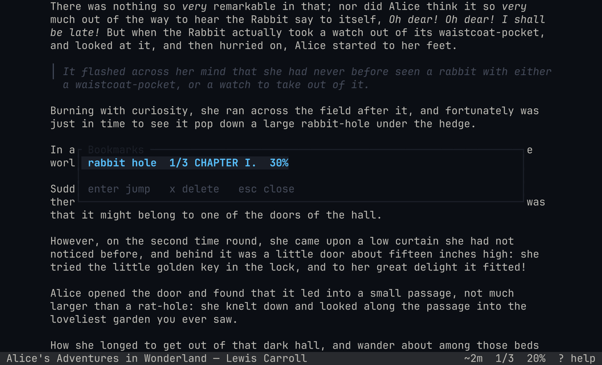
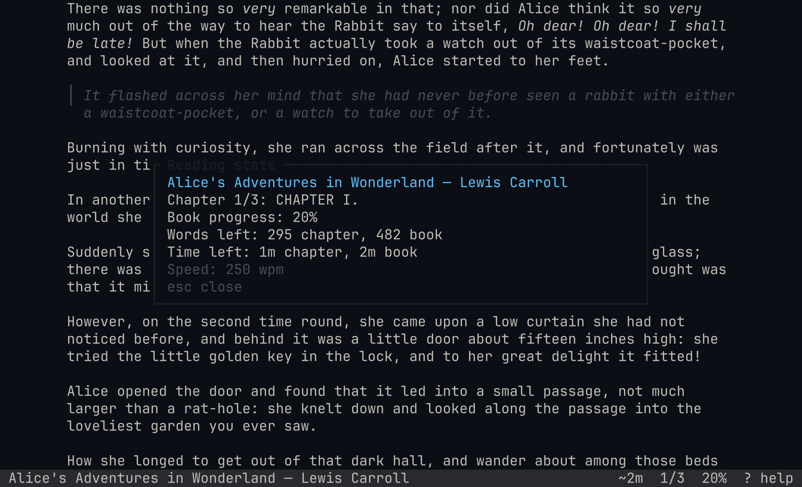
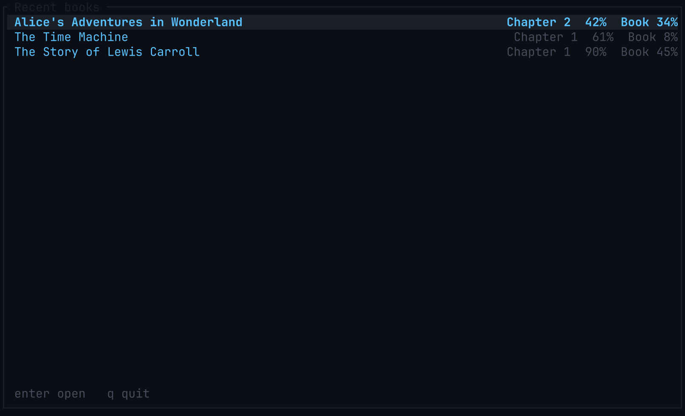

# slurp

A terminal EPUB reader with vim-like keys, full-text search, percentage
jumps, inline images, and per-book reading positions.

```
slurp book.epub
```

## Screenshots

All screenshots use the built-in `ayu-dark` theme.


*Reading view: reflowed text, emphasis, quotes, and the status line.*


*Optional paragraph color bars (`p`): five theme colors cycle through the
text.*


*Contents popup with fuzzy filtering.*


*Full-text search with highlighted matches and a match counter.*



*Named bookmarks with chapter and chapter progress.*



*Reading time and words left for the chapter and the book.*



*Recent books with chapter and whole-book progress.*

## Features

- Reflows EPUB text to any terminal width. Set a maximum text width in the
  config file or change it while reading with `+` and `-`.
- Vim-like scrolling and chapter navigation. Chapters follow the EPUB
  table of contents, including several chapters inside one file.
- Full-text search across all chapters with `/`, and match highlighting.
- Follow internal links and footnotes with `Tab`, `Enter`, and `Ctrl+O` to go
  back.
- Named bookmarks per book with `m` and `'`, including a jump back to the
  saved place.
- Jump anywhere in the book with `%` and a percentage.
- Auto-scroll at a configurable speed in words per minute. It stops at
  popups and moves to the next chapter when the screen ends.
- Optional continuous mode that scrolls through all chapters as one stream,
  with no chapter switch needed. Two blank rows separate chapters.
- Optional thin color lines left of each paragraph. Five theme colors cycle
  through the text, so a paragraph is easy to find again after scrolling.
- The `t` popup uses the EPUB table of contents with fuzzy filtering. If the
  book has none, the popup says so.
- Inline images with Sixel, Kitty, iTerm2, or Unicode halfblocks.
- Remembers the chapter and scroll position for each book and returns to the
  same place on the next start.
- Shows the time left for the chapter and the book, in the status line and in
  a popup on `s`.
- Runs without a book and opens a recent-books list with chapter and
  whole-book progress. `x` removes the selected book and its saved position,
  `c` removes every entry whose file is missing.
- Saves theme, width, and mode changes back to the config file with `S`,
  keeping comments and unrelated keys.
- Uses the 39 built-in [opaline](https://crates.io/crates/opaline) themes.
  Press `Ctrl+T` to search the themes and preview them live.
  Every color role can be overridden in the config file.
- Images can be turned off from the config file or with `i`.
- The mouse wheel scrolls, and a click opens an entry in a popup.

## Build

```sh
cargo build --release
```

The binary is `target/release/slurp`.

## Keys

| Key | Action |
| --- | --- |
| `j` / `k`, `Down` / `Up` | Scroll one line |
| `d` / `u` | Scroll half a page |
| `Space` | Start of the next paragraph |
| `PageDown` / `PageUp`, `b` | Scroll one page (`b` goes up) |
| `g` / `G`, `Home` / `End` | Start or end of the chapter |
| `h` / `l`, `Left` / `Right` | Previous or next chapter |
| `t` | Fuzzy-searchable table of contents from the EPUB |
| `%` | Jump to a percentage of the book |
| `/` | Search all chapters |
| `Enter` | Run the search, apply the percentage, follow the selected link, or open the selected chapter |
| `Tab` | Select the next link in the chapter |
| `Ctrl+O` | Go back after following a link |
| `n` / `N` | Next or previous match |
| `m` | Add a named bookmark |
| `'` | Open the bookmark list (`Enter` jumps, `x` deletes) |
| `s` | Reading stats for the chapter and the book |
| `S` | Save the changed settings to the config file |
| `i` | Toggle images |
| `a` | Toggle auto-scroll |
| `c` | Toggle continuous mode |
| `p` | Toggle paragraph color bars |
| `[` / `]` | Slower or faster auto-scroll (25 words per minute steps) |
| `Ctrl+T` | Theme selector with search and live preview |
| `+` / `-` | Wider or narrower text column |
| `?` | Show the key help |
| `Esc` | Cancel a prompt, close a popup, or clear the search |
| Mouse wheel, click | Scroll the page, and activate entries in popups |
| `q`, `Ctrl-C` | Save the position and quit |

## Configuration

The config file is `$XDG_CONFIG_HOME/slurp/config.toml`, usually
`~/.config/slurp/config.toml`. Every key is optional.

```toml
# A built-in theme name, or a path to a theme TOML file.
theme = "catppuccin-mocha"

# Maximum width of the text column, in terminal cells.
text_width = 80

# Minimum empty cells on each side of the text column.
margin = 2

# Empty rows above the text.
top_margin = 1

# Empty rows between the text and the status line.
bottom_margin = 1

# Empty rows between paragraphs.
paragraph_spacing = 1

# Maximum height of an image, in rows.
image_max_height = 20

# Draw images. When false, images show as a text placeholder.
images = true

# Auto-scroll speed, in words per minute.
auto_scroll_wpm = 200

# Reading speed, in words per minute, used for the time estimate.
reading_wpm = 250

# Scroll through all chapters as one stream.
continuous = false

# Draw a color bar left of each paragraph, cycling through five theme colors.
paragraph_colors = false

# Optional per-role colors. Values are "#rrggbb".
[colors]
text = "#cdd6f4"
background = "#1e1e2e"
heading = "#cba6f7"
accent = "#74c7ec"
muted = "#a6adc8"
search = "#f9e2af"
search_text = "#1e1e2e"
status_bg = "#181825"
status_fg = "#cdd6f4"
border = "#585b70"
selection = "#313244"
```

List the built-in themes:

```sh
slurp --list-themes
```

A theme file can also come from opaline's theme format:

```toml
theme = "/home/me/themes/my-theme.toml"
```

## Images

slurp chooses a graphics protocol from the terminal environment:

- Kitty and Ghostty: Kitty graphics protocol.
- iTerm2 and WezTerm: iTerm2 inline images.
- foot, mlterm, yaft: Sixel.
- Everything else: Unicode halfblocks, which works in any 256-color terminal.
- Inside tmux or screen: halfblocks, because the passthrough setup for the
  other protocols is not available.

Images are read when they first become visible. Large chapters open quickly
even when they contain many images.

## Reading position

Positions are saved in `$XDG_DATA_HOME/slurp/positions.toml`, usually
`~/.local/share/slurp/positions.toml`. The file keeps the chapter and the
scroll fraction for each book. A position is saved when the chapter changes,
when you quit, and when the program exits.

## Command line

```
slurp [OPTIONS] [BOOK.epub]

Without a book, slurp opens the recent-books list.

  -c, --config <FILE>   Use a specific config file
      --state <FILE>    Use a specific reading position file
  -t, --theme <NAME>    Start with a built-in theme
  -w, --width <COLS>    Set the text column width
      --list-themes     List the built-in themes
  -h, --help            Show help
  -V, --version         Show the version
```

## License

MIT
